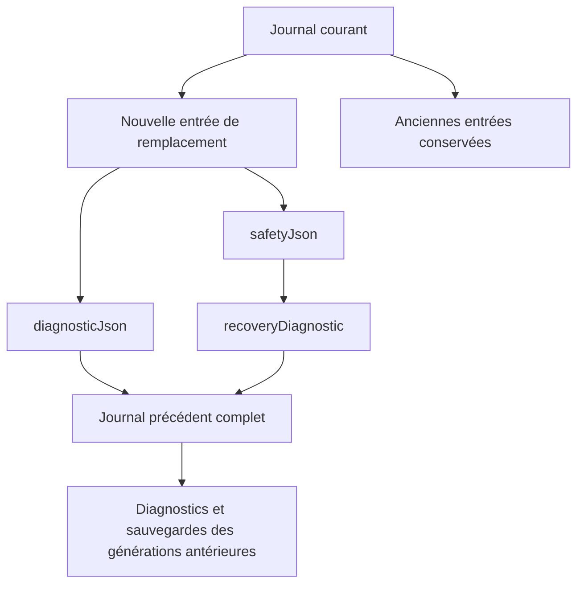

# 97C-2B3D7 — Recette finale Ressources isolées

29 octobre 2026. **Décision : NO-GO pour le pilote contrôlé dans le périmètre demandé.**

Les contrôles d’isolation et de conservation passent dans les scénarios exécutés. Deux anomalies bloquent toutefois le pilote : la croissance des archives imbriquées dépasse le quota natif après quelques remplacements d’une ressource minuscule ; après une interruption sous quota insuffisant, la récupération manuelle peut elle-même manquer d’espace. **Aucun correctif applicatif n’est effectué dans cette étape.**

## Sécurité et périmètre

- Aucun compte réel, aucune donnée réelle, aucun appel Supabase, aucune migration réelle. Les profils sont neufs et les clés fictives préfixées par scénario. Le serveur autonome ne charge pas le SDK Supabase et bloque les requêtes externes.
- Production inchangée : `ACCOUNT_SCOPED_RESOURCES_ENABLED = false`, `RESOURCE_JSON_REPLACEMENT_ENABLED = false`, `MANUAL_RESOURCE_RECOVERY_ENABLED = false`, `CLOUD_SYNC_SUSPENDED = true`.
- Aucun fichier `app/`, manifeste de dépendances ou lockfile modifié. Les modifications concernent uniquement le banc de recette, ses mesures et ce rapport. Aucun journal ou ancienne donnée réelle supprimé.
- Vrai Google Chrome **156.0.8078.49**, piloté par Playwright en mode headless, plusieurs onglets et Web Locks natif. Firefox, Safari et Edge ne sont pas validés par cette recette. Les sessions sont synthétiques ; il ne s’agit pas d’une connexion à un service d’authentification distant.
- L’activation des fonctions existe uniquement dans le bundle en mémoire du serveur de recette. Les empreintes source sont contrôlées avant/après par les fixtures. Le build n’inclut aucune route de recette ; les marqueurs `chainRecipe`, `tpc-chain:` et `quotaAfterJournal` sont absents des sorties `.next/server` et `.next/static` inspectées.

## Vérifications exécutées

| Commande / contrôle | Résultat |
|---|---|
| `node --test tests/*.test.mjs tests/cloud-sync-suspension.cjs` | **19/19 fichiers réussis** |
| `npm run test:browser -- --config=playwright.resource-final-audit.config.mjs` | **40/40 tests réussis**, aucun retry, aucun échec inattendu |
| `node_modules\.bin\tsc.cmd --noEmit` | Réussi |
| ESLint ciblé sur les fichiers de recette modifiés/ajoutés | Réussi sans avertissement |
| `npm run build` | Réussi, Next.js 16.4.3, 20 pages générées |

Les tests de quota et de croissance sont verts parce qu’ils contrôlent les refus et la conservation de l’état. Ils ne prouvent pas l’aptitude au pilote : les critères « croissance maîtrisée » et « récupération disponible sous quota insuffisant » ne sont pas validés.

ESLint ciblé :

```text
node_modules\.bin\eslint.cmd tests/browser/resource-chain-harness.mjs tests/browser/resource-json-replacement.spec.mjs tests/browser/resource-final-audit.spec.mjs tests/helpers/resourceStorageMetrics.mjs tests/resource-storage-growth-audit.test.mjs playwright.resource-final-audit.config.mjs
```

## Scénarios fonctionnels validés

| Scénario | Observation |
|---|---|
| Migration A | Aperçu, sauvegarde JSON téléchargée et relue, confirmations, copie vérifiée et anciennes clés conservées |
| Initialisation B neuf | Action explicite vers `[]`, propriétaire confirmé, aucun marqueur de migration inventé et aucune reprise de l’historique A |
| CRUD A et B | Ajout, modification et suppression par les vrais composants React pour chaque compte ; copies antérieures conservées dans le journal |
| Déconnexion et transitions | Cartes masquées à la déconnexion ; A/B restent séparés ; retour sur A avec ses octets conservés avant ses propres nouvelles modifications |
| Sauvegarde et remplacement | Fichier propriétaire confirmé, aperçu avant/après, sauvegarde complète téléchargée puis relue, confirmation séparée ; liste vide volontaire également validée |
| Fichier d’un autre compte / sans propriétaire | Refus sans modification de la destination ; JSON malformé refusé |
| Import interrompu | Rafraîchissement, diagnostic et blocage des écritures ordinaires ; journal et copies présents |
| Récupération avec espace disponible | Sélection saine, sauvegarde diagnostic relue et confirmation explicite ; retour exact aux octets précédents, sans suppression des entrées |
| Concurrence | Deux onglets : un succès, un conflit obligatoire, aucun écrasement silencieux ; initialisations concurrentes également contrôlées |
| Session expirée | Écran masqué, ancien handle d’écriture et export refusés ; ressources A/B inchangées |
| Web Locks absent / lecture impossible | Refus sécurisé ; aucune liste vide inventée et aucun pseudo-verrou localStorage |
| Ressources vers Prospects | Commandes d’historique et de relance indisponibles ; aucune écriture dans les anciens Prospects |
| Quota avant journal | Refus avant toute modification ; état intégral précédent et fichier préalable inchangés |
| Quota après journal | Anciennes ressources intactes, nouvelle entrée et marqueur `pending` conservés ; diagnostic exportable et nouvelles écritures bloquées |

La suite réexécute les 36 tests précédents et ajoute quatre scénarios : croissance jusqu’au quota natif, quota chiffré avant journal, quota chiffré après journal avec tentative de récupération, CRUD complet des deux comptes et expiration. Les tests unitaires ajoutent une analyse bornée des archives et des remplacements successifs sous budget mesuré en mémoire.

## Mesure du stockage : D7-01, anomalie bloquante

**Reproduction :** profil vierge, jeu fictif A d’une seule ressource, migration manuelle, puis cinq tentatives de remplacement de cette ressource par une autre ressource de taille presque constante. À chaque tentative, la vraie interface télécharge et relit sa sauvegarde préalable. Aucun quota synthétique n’est imposé dans ce scénario.

| Remplacement | Résultat | Journal UTF-8 (octets) | Journal estimé UTF-16 (octets) | Fichier préalable UTF-8 réellement téléchargé (octets) | Profondeur historique décodée |
|---|---|---:|---:|---:|---:|
| 0 : migration | Vérifié | 432 | 864 | — | 0 |
| 1 | Vérifié | 9 869 | 19 642 | 4 112 | 1 |
| 2 | Vérifié | 52 877 | 105 350 | 16 136 | 2 |
| 3 | Vérifié | 310 771 | 620 214 | 80 717 | 3 |
| 4 | Vérifié | 2 242 067 | 4 480 034 | 531 640 | 4 |
| 5 | Quota natif, refus | 2 242 067 conservés | 4 480 034 conservés | 4 199 088 | 4 persistée ; niveau supplémentaire refusé |

Après chaque remplacement réussi, les Ressources ne représentent que **180 octets UTF-8 / 360 octets estimés UTF-16**. Après quatre remplacements, le journal représente environ **12 445 fois** la taille UTF-16 des données courantes. Ses facteurs de croissance successifs après le premier remplacement sont environ **5,36**, **5,89** et **7,22**.

Après le quatrième remplacement, l’ensemble des clés/valeurs du profil fictif représente **4 485 054 octets estimés UTF-16**. Au cinquième, l’application tente d’écrire un journal de **36 892 190 octets estimés UTF-16**, pour un total projeté de **36 897 210**. Le `setItem` natif renvoie `QuotaExceededError` avant de remplacer le journal. **L’ensemble du stockage est alors exactement inchangé** ; le dernier état vérifié et toutes ses copies persistent.

Les cinq fichiers préalables du scénario totalisent **4 831 693 octets UTF-8 sur le disque de recette**, hors fichiers de migration et autres preuves. Le cinquième fichier reste disponible malgré le remplacement refusé.

### Interprétation des unités

Les octets UTF-8 des fichiers sont mesurés sur disque ; ceux du journal sont calculés sur sa chaîne stockée. L’estimation UTF-16 correspond à deux octets par unité de chaîne JavaScript. L’estimation de profil inclut les noms physiques préfixés et les valeurs, mais pas les métadonnées ou la représentation interne du navigateur. **Ce n’est ni une mesure disque de Chrome ni une valeur universelle de quota.** On observe le refus de cette écriture précise ; on ne déduit pas que toute la capacité de l’origine est consommée ou que de petites écritures seraient nécessairement impossibles.

### Récursion / imbrication

Aucune boucle de références JavaScript ni erreur de pile n’est observée dans l’échantillon. Chaque fichier reste un JSON fini. En revanche, le contenu se réembarque dans les générations suivantes : il s’agit d’une **auto-imbrication historique non bornée**, avec rééchappement des chaînes, et non d’un simple journal à croissance linéaire.

L’absence de récursion excessive ne peut donc pas être validée au sens de la représentation des sauvegardes. Le quota est rencontré avant une campagne longue. L’inspecteur de recette utilise une boucle bornée à 16 couches et 64 Mio de chaînes décodées ; aucune de ces bornes n’est atteinte dans la mesure. Ces bornes protègent uniquement l’analyse de test et ne sont pas une correction du produit.

## Mécanismes responsables

1. `app/lib/resourceWriteCoordinator.ts:86` : l’export de diagnostic inclut `rawJournal` complet, puis le sérialise.
2. `app/lib/resourceBackupJson.ts:97` et `:109` : l’aperçu récupère ce diagnostic et l’intègre dans `safetyJson.recoveryDiagnostic`, avec les données actuelles et leurs octets bruts.
3. `app/lib/resourceWriteCoordinator.ts:173` : chaque entrée de remplacement ajoute au journal existant **à la fois** `replacement.diagnosticJson` et `replacement.safetyJson`. Les deux contiennent le même journal précédent, lequel contient déjà ses propres archives. `stagedRaw` et les snapshots ajoutent des copies de données, mais sont marginaux dans cette mesure.
4. `app/lib/resourceBackupJson.ts:184` et `app/lib/resourceWriteCoordinator.ts:176` : la récupération archive elle aussi un diagnostic contenant le journal complet ; elle peut amplifier le même phénomène.
5. `app/lib/resourceRecoveryAssessment.ts:6` : les contrôles reparsent et resérialisent diagnostics et sauvegardes. Ils ne créent pas le stockage persistant, mais ajoutent du travail et des allocations à mesure que les chaînes grandissent.



Retirer uniquement l’un des deux champs redondants réduirait le volume, mais ne supprimerait pas la réinclusion répétée de tout l’historique. Une simple compression ou un avertissement à 1 Mio ne démontre pas une croissance maîtrisée.

## D7-02 — Récupération également refusée sous quota insuffisant

Deux budgets sont imposés uniquement par la façade de stockage fictive du banc, sans remplir ou supprimer de vraies clés.

**Avant journal :** budget fixé à l’estimation courante de **5 896 octets**. L’écriture projetée demande **24 794 octets**. Le refus laisse toutes les clés identiques et le fichier préalable intact.

**Après journal :** source fictive avec 64 Kio de notes ; le journal de préparation est d’abord persisté. Le budget est ensuite fixé à **287 826 octets**. Le marqueur `pending` passe et l’usage estimé est **286 714 octets** ; l’écriture des Ressources demanderait **417 772 octets**, elle est refusée. Les anciennes ressources et toutes les copies restent présentes ; le diagnostic existant exporte `recovery-required`.

La récupération manuelle est alors tentée avec une copie saine, une nouvelle sauvegarde relue et confirmation, **sans lever le budget**. Son journal demanderait **591 838 octets** : il est refusé à son tour. L’état après cet échec reste exactement celui suivant le premier refus. Aucun succès ni nettoyage automatique n’est annoncé.

**Conséquence :** les données précédentes sont conservées dans ce scénario, mais la disponibilité de la récupération sous quota insuffisant n’est pas garantie. Un utilisateur peut rester bloqué malgré des copies saines. Ce problème est reproduit et laissé ouvert ; aucune récupération de données réelles n’est tentée.

## Stratégie de limitation proposée, sans suppression de copies utiles

Cette stratégie nécessite une étape distincte de conception, versionnement, implémentation et recette ; elle n’est pas appliquée ici.

1. **Archives plates et références.** Enregistrer chaque snapshot brut une fois dans un espace propre au propriétaire, avec identifiant, taille et empreinte. Les opérations référencent les snapshots avant/après ; un diagnostic référence le manifeste et ces identifiants, sans contenir les anciens journaux complets.
2. **Sauvegarde complète mais non auto-imbriquée.** Exporter un paquet versionné contenant un manifeste plat, les blobs uniques nécessaires et les artefacts historiques à conserver. Ne jamais réinjecter le paquet complet dans l’entrée suivante : conserver un reçu de vérification et des références suffisantes pour retrouver les copies. Le périmètre de déduplication doit rester celui du propriétaire.
3. **Préserver les preuves existantes.** Inventorier toutes les entrées, y compris les opérations incomplètes et l’entrée d’initialisation. Conserver leurs octets exacts et diagnostics dans une archive vérifiée avec contrôle du propriétaire, empreintes et test de relecture/restauration. Aucune suppression fondée uniquement sur l’âge ou la taille ; aucune transformation destructive de l’historique actuel sans procédure explicitement autorisée.
4. **Budget avant mutation.** Calculer la représentation réellement sérialisée du candidat, du journal et des marqueurs avant la première écriture ; définir des plafonds validés et une réserve pour une intervention manuelle. Refuser explicitement l’opération avant journalisation si les plafonds sont dépassés. Les estimations de quota navigateur ne constituent pas une réservation atomique : les exceptions de stockage doivent toujours rester traitées.
5. **Récupération à faible coût d’écriture.** Réutiliser les snapshots et références préparés plutôt que recopier encore le journal complet pendant la récupération. Démontrer son comportement sous budget contraint. Étudier séparément un stockage transactionnel adapté, par exemple IndexedDB, si une garantie de validation multi-objets est nécessaire ; toute migration réelle resterait une étape distincte. Aucun stockage ne garantit la survie à une perte physique du profil.
6. **Lecture et import bornés.** Définir des limites explicites de fichier, de couches historiques et de volume décodé, avec refus compréhensible et diagnostic en lecture seule. Les contrôles ne doivent pas matérialiser sans borne les anciens journaux.

Conserver une copie utile vérifiée par référence ne signifie pas la supprimer. Une future réorganisation doit prouver la conservation des octets d’origine et la restauration avant toute éventuelle élimination de redondances. **Aucune copie n’est nettoyée dans cette recette.**

## Corrections indispensables avant activation

- Supprimer l’auto-imbrication du format actif et valider une croissance bornée/proportionnelle au nombre de snapshots utiles.
- Traiter D7-02 : prévention des dépassements avant mutation et parcours de récupération qui n’exige pas une nouvelle copie complète de tout l’historique.
- Rejouer des dizaines de remplacements, récupérations et éditions sous budgets chiffrés, avec fichiers plus volumineux, interruptions aux quatre phases et contrôle exact de toutes les copies conservées.
- Démontrer le maintien des garanties d’isolation, de session, de confirmation et de conservation dans le nouveau format, y compris sa compatibilité avec les journaux existants et l’initialisation des comptes neufs.
- Revalider l’intégration navigateur/authentification dans l’environnement dédié prévu pour le pilote et expliciter les navigateurs supportés. Toute activation de production exige une décision distincte ; le cloud et les actions vers Prospects non isolés restent bloqués.

## Risques restants

localStorage reste non transactionnel entre clés : une interruption peut laisser un état partiel. Les tests démontrent la conservation dans les scénarios exécutés, pas l’absence absolue de risque de perte physique, d’éviction du profil, d’altération par un script de même origine ou d’erreur de disque. Les sauvegardes externes vérifiées demeurent nécessaires.

Le quota est commun à l’origine : la croissance d’un compte constitue aussi un risque de disponibilité pour les autres, même lorsque les clés ne se mélangent pas. Cette contention entre comptes est un risque inféré de l’architecture, pas une fuite de données observée par cette recette. Les temps collectés incluent instrumentation et automatisation ; ils ne sont pas un benchmark de performance de production. La consommation du tas JavaScript n’a pas été profilée.

**Avis final : NO-GO.** L’absence de mélange observée et les 40 tests réussis ne compensent pas les deux blocages de capacité/récupération. Le code applicatif reste inchangé pour permettre une correction dédiée, revue et mesurable.

## Fichiers modifiés et preuves

- `tests/browser/resource-chain-harness.mjs` : mesure des clés/valeurs, budgets fictifs et trace des refus natifs ; aucune modification du stockage applicatif.
- `tests/browser/resource-json-replacement.spec.mjs` : export du helper de préparation pour réutiliser les mêmes confirmations et fichiers.
- `tests/browser/resource-final-audit.spec.mjs` : quatre nouveaux scénarios de recette et preuves chiffrées.
- `tests/helpers/resourceStorageMetrics.mjs` : métriques UTF-8/UTF-16 et inspection historique itérative bornée.
- `tests/resource-storage-growth-audit.test.mjs` : unités, bornes, modules réels en mémoire et quotas.
- `playwright.resource-final-audit.config.mjs` : suite complète, aucun retry ni augmentation des délais, sorties D7 séparées.
- Ce rapport.

Preuves : `test-results/resource-final-audit-97C-2B3D7/browser-results.json`, `verification.json`, `discovery-growth.json`, et pièces par scénario `growth-measurements.json`, `quota-before-journal.json`, `quota-after-journal.json`, fichiers de sécurité et diagnostic. `verification.json` contient les empreintes du code applicatif et des preuves, l’absence de diff `app/`, les contrôles des indicateurs, les chiffres de croissance et la décision NO-GO. Ces artefacts sont ignorés par Git : les archiver séparément avec le rapport. Les preuves D1 à D6B restent conservées à leurs emplacements antérieurs.
